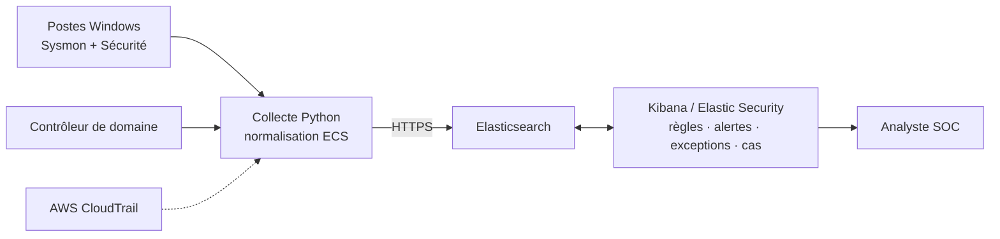

# MediSoft — Projet SOC complet : superviser, détecter et répondre

> Projet personnel d'**Elie MEHINTO**, étudiant en Master 2 Cybersécurité & Réseaux, **en recherche de stage de fin d'études et d'alternance en cybersécurité (SOC, GRC)**.

## En une phrase

J'ai construit et fait fonctionner, de A à Z, le **service SOC** qui surveille **MediSoft**, un éditeur SaaS de dossier patient informatisé : plateforme SIEM, normalisation des journaux, règles de détection, tests purple team, tuning, procédures de traitement, enquêtes, détection cloud et indicateurs.

## Pourquoi ce projet

Ce projet est construit à partir des **missions réelles d'offres de stage d'analyste SOC** : un SOC managé (MSSP) et l'équipe Dynamic SOC XDR d'un grand opérateur. Chaque module reproduit une ou plusieurs de ces missions et produit les livrables qu'un stagiaire SOC réalise en entreprise.

C'est la suite de mon [projet GRC MediSoft](https://github.com/eliemehintookou/medisoft-grc-project) : après avoir **mis en place la gouvernance** de la sécurité, je **supervise et défends** la même entreprise. Les procédures d'incident et les playbooks rédigés dans le projet GRC sont ceux que le SOC applique ici.

## Missions des offres → modules

| Mission demandée dans les offres | Module |
|---|---|
| Configurer les solutions de sécurité chez les clients | 1, 4 |
| Élaborer des documentations techniques, spécifications générales et détaillées | 1 (et tous) |
| Améliorer les règles de détection automatiques, enrichir les scénarios existants | 2 |
| Améliorer les capacités de corrélation, nouveaux scénarios (lab, purple team) | 3 |
| Gestion des exclusions, création de règles de détection | 2, 4 |
| Comprendre les mécanismes de protection avancés contre les menaces actuelles | 2, 3 |
| Monitorer, qualifier et traiter les incidents de sécurité en temps réel | 5 |
| Diagnostiquer un incident et mener les actions de remédiation | 5 |
| Rédiger des procédures de traitement des alertes | 5 |
| Études des environnements cloud, enrichissement des règles de détection | 6 |
| Intégrer des solutions orientées EDR, XDR, cloud | 1, 6 |
| Proposer des processus plus performants, faire évoluer le service | 7 |

## Les modules

| Module | Sujet | Statut |
|---|---|---|
| [1](module1/) | **Mise en place du SOC** : plateforme Elastic Security sécurisée, collecte et normalisation ECS, spécifications | 🟡 En cours |
| 2 | **Ingénierie de détection** : règles Sigma, conversion, mapping MITRE ATT&CK | ⚪ À venir |
| 3 | **Purple team et corrélation** : Atomic Red Team, règles de séquence EQL | ⚪ À venir |
| 4 | **Tuning et exclusions** : faux positifs, exceptions justifiées, mesure du bruit | ⚪ À venir |
| 5 | **Traitement des incidents** : procédures par alerte, deux enquêtes complètes | ⚪ À venir |
| 6 | **Détection cloud** : AWS CloudTrail, clés exposées, buckets publics | ⚪ À venir |
| 7 | **Amélioration du service** : enrichissement automatique (Python), MTTD/MTTR, tableau de bord | ⚪ À venir |

## Architecture



## Outils

Elastic Security 8.19 (Elasticsearch, Kibana) · Docker · Python · Sysmon · Sigma · Atomic Red Team · MITRE ATT&CK · AWS CloudTrail · jeux de données OTRF Security-Datasets

## Structure du dépôt

```
docs/      Spécifications générale et détaillée du service et de la plateforme
lab/       docker-compose, modèle de configuration .env, guide d'installation
scripts/   Collecte et normalisation des journaux (Python)
module1/   Livrables et preuves du module 1
```

## Démarrage rapide

Voir [`lab/INSTALLATION.md`](lab/INSTALLATION.md).
