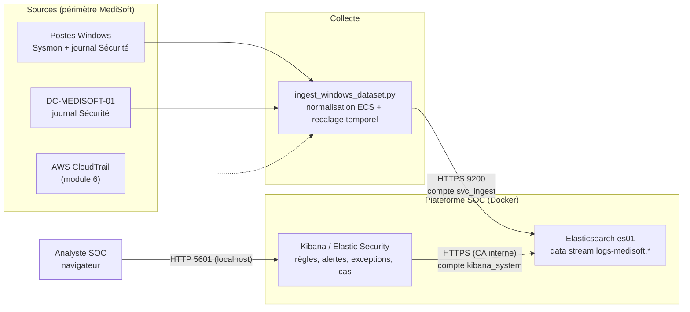

# MS-SOC-SPD-01 — Spécification détaillée de la plateforme SOC

| | |
|---|---|
| Référence | MS-SOC-SPD-01 |
| Version | 1.0 — novembre 2026 |
| Auteur | Elie MEHINTO |
| Documents liés | MS-SOC-SPG-01 (spécification générale), `lab/INSTALLATION.md` |

---

## 1. Architecture

**Choix d'Elastic Security.** On aurait pu reprendre Wazuh, déjà utilisé dans le projet de M1. Elastic Security a été choisi pour quatre raisons :

1. **Moteur de détection complet en licence gratuite (Basic)** : règles de requête, de seuil et de séquence EQL (corrélation, module 3), exceptions (module 4) et cas d'investigation (module 5).
2. **Normalisation ECS**, un schéma de champs commun très répandu, utilisé aussi comme cible de conversion par Sigma.
3. **Outil courant dans les SOC prestataires**, ce qui élargit le profil après le projet Wazuh.
4. **Consommation mémoire maîtrisable** en mono-nœud sur un PC de 8 Go.

## 2. Composants et versions

| Composant | Image | Version | Rôle | Ressources |
|---|---|---|---|---|
| setup | `elasticsearch` | 8.19.21 | Génère la CA et les certificats, initialise `kibana_system` ; s'arrête ensuite | Temporaire |
| es01 | `elasticsearch` | 8.19.21 | Stockage, indexation, recherche, exécution des requêtes de détection | Heap Java 1 Go, limite 2 Go |
| kibana | `kibana` | 8.19.21 | Interface d'analyse, Elastic Security | Limite 1,5 Go |

La version est fixée dans `.env` (`STACK_VERSION`). Elasticsearch et Kibana doivent toujours avoir **exactement** la même version.

## 3. Flux réseau

| Flux | Source | Destination | Port | Protocole | Authentification |
|---|---|---|---|---|---|
| F1 Ingestion | Script de collecte (hôte) | es01 | 9200 | HTTPS (CA interne) | `svc_ingest` (écriture seule) |
| F2 Plateforme | kibana | es01 | 9200 | HTTPS (CA interne) | `kibana_system` |
| F3 Analyste | Navigateur | kibana | 5601 | HTTP local | Compte nominatif `analyste.n1` |
| F4 Administration | Hôte | es01 | 9200 | HTTPS | `elastic` (réservé à l'administration) |

Les ports 9200 et 5601 ne sont publiés que sur `127.0.0.1`. La plateforme n'est donc **pas joignable depuis le réseau**, ce qui remplace dans le lab le filtrage réseau d'un vrai SOC.

## 4. Sécurité de la plateforme

| Mesure | Mise en œuvre |
|---|---|
| Authentification obligatoire | `xpack.security.enabled=true` : toute requête sans identifiants est refusée |
| Chiffrement | TLS sur l'API HTTP d'Elasticsearch, avec une CA propre au lab générée par `elasticsearch-certutil` |
| Secrets | Mots de passe et clé de chiffrement Kibana dans `.env`, exclu de Git |
| Moindre privilège | Le super-administrateur `elastic` ne sert qu'à l'administration. L'ingestion utilise un compte technique qui ne peut qu'**ajouter** des documents, et l'analyste un compte nominatif sans droits d'administration |
| Clé de chiffrement Kibana | Obligatoire pour stocker les règles et les connecteurs chiffrés (`XPACK_ENCRYPTEDSAVEDOBJECTS_ENCRYPTIONKEY`) |

### Comptes et rôles

| Compte | Rôle | Droits | Pourquoi |
|---|---|---|---|
| `elastic` | superuser | Tous | Administration uniquement, jamais au quotidien |
| `kibana_system` | kibana_system | Interne | Compte technique de Kibana |
| `svc_ingest` | `medisoft_ingest` | `create_doc` et `auto_configure` sur `logs-medisoft.*` | Le script de collecte ne peut ni lire, ni modifier, ni supprimer les journaux. Si ses identifiants fuitent, un attaquant ne peut pas effacer ses traces |
| `analyste.n1` | `soc_analyste` | Lecture de `logs-*`, gestion des alertes, fonctionnalité Security de Kibana | Travail quotidien de l'analyste |

## 5. Stockage

| Élément | Valeur |
|---|---|
| Data stream | `logs-medisoft.windows-default` (Windows), `logs-medisoft.aws-default` (module 6) |
| Modèle d'index | Modèle intégré `logs` (`logs-*-*`) : mappings ECS automatiques (`ecs@mappings`), types `ip`, `date`, `keyword` |
| Cycle de vie | Politique intégrée `logs` (bascule automatique des index) |
| Vue de données | `logs-medisoft*`, et `logs-*` dans Elastic Security (valeur par défaut) |

Le nommage `logs-<jeu>-<espace>` suit la convention des data streams d'Elastic. Le modèle intégré applique alors tout seul les bons types aux champs ECS, sans modèle à écrire.

## 6. Normalisation ECS

### 6.1 Principe

Le script `scripts/ingest_windows_dataset.py` lit les événements bruts et produit des documents ECS. **Tous les champs d'origine sont conservés** sous `winlog.event_data.*` pour l'investigation.

### 6.2 Champs communs

| Champ brut | Champ ECS |
|---|---|
| `EventID` | `event.code`, `winlog.event_id` |
| `Channel` | `winlog.channel` |
| `SourceName` | `event.provider` |
| `Hostname` | `host.name` (renommé selon la convention MediSoft) |
| `@timestamp` / `TimeCreated` / `EventTime` | `@timestamp` (UTC) |
| — | `event.module` (`sysmon` ou `security`), `event.action`, `event.category`, `event.type` |

### 6.3 Sysmon

| Event ID | Signification | Champs ECS principaux |
|---|---|---|
| 1 | Création de processus | `process.executable`, `process.name`, `process.command_line`, `process.pid`, `process.parent.*`, `process.hash.*`, `user.name`, `user.domain` |
| 3 | Connexion réseau | `source.ip/port`, `destination.ip/port`, `destination.domain`, `network.transport`, `process.*` |
| 7 | Chargement de DLL | `dll.path`, `dll.name`, `dll.hash.*` |
| 8 / 10 | Thread distant / accès à un processus | `process.*` (processus source) ; cible et droits dans `winlog.event_data.TargetImage` et `GrantedAccess` |
| 11 / 23 | Fichier créé / supprimé | `file.path`, `file.name` |
| 12 / 13 | Registre | `registry.path`, `registry.value`, `registry.data.strings` |
| 22 | Requête DNS | `dns.question.name` |

### 6.4 Journal Sécurité

| Event ID | Signification | Champs ECS principaux |
|---|---|---|
| 4624 / 4625 | Connexion réussie / échouée | `event.category: authentication`, `event.outcome`, `user.name`, `source.ip`, `winlog.logon.type` |
| 4634 / 4648 / 4672 | Déconnexion / identifiants explicites / privilèges spéciaux | Idem |
| 4688 | Création de processus | `process.*`, `process.parent.*` |
| 4697 / 4698 | Service installé / tâche planifiée créée | `service.name`, `winlog.event_data.TaskName` |
| 4720 / 4728 / 4732 | Compte créé / ajout à un groupe | `event.category: iam`, `user.name`, `group.name` |
| 4769 | Ticket de service Kerberos | `service.name`, `source.ip` |

### 6.5 Nettoyage des valeurs

- Les valeurs vides de Windows (`-`, chaîne vide) sont supprimées pour éviter les rejets de type.
- Les adresses `::ffff:10.0.1.5` (IPv4 encapsulée dans de l'IPv6) sont ramenées à `10.0.1.5`.
- Les identifiants de processus en hexadécimal (`0x12d8`) sont convertis en entiers.
- `DOMAINE\utilisateur` est séparé en `user.domain` et `user.name`.

## 7. Recalage temporel

Les jeux de données OTRF datent de 2020-2021. Or les règles d'Elastic Security s'exécutent à intervalle régulier et ne regardent qu'une courte fenêtre de temps (par exemple les 5 dernières minutes). Un événement de 2020 ne déclencherait jamais rien.

L'option `--rebase-time` calcule l'écart entre l'événement le plus récent du lot et l'heure actuelle, puis l'ajoute à **tous** les événements. La chronologie interne de l'attaque (ordre et écarts entre les événements) est conservée, ce qui est indispensable pour les règles de corrélation du module 3. Les documents rejoués portent le tag `replay`, pour les distinguer des tests en direct.

## 8. Conventions de nommage

| Objet | Format | Exemple |
|---|---|---|
| Postes | `WS-<SERVICE>-<NN>` | `WS-COMPTA-07`, `WS-DEV-03` |
| Serveurs | `DC-MEDISOFT-01`, `SRV-<RÔLE>-<NN>` | `SRV-FICHIERS-01` |
| Règles de détection | `MS-DET-<NNN> — <description>` | `MS-DET-003 — Accès mémoire à LSASS` |
| Exceptions | `MS-EXC-<NNN>` | `MS-EXC-001` |
| Incidents SOC | `INC-SOC-<AAAA>-<NNN>` | `INC-SOC-2026-001` |
| Procédures de traitement | `MS-SOC-PTA-<NNN>` | `MS-SOC-PTA-003` |

## 9. Recette du module 1

| Test | Attendu | Commande ou action |
|---|---|---|
| R1 — Santé du cluster | `status` : `green` ou `yellow` (normal en mono-nœud) | `curl --cacert ca.crt -u elastic https://localhost:9200/_cluster/health?pretty` |
| R2 — Accès refusé sans identifiants | `missing authentication credentials` | `curl --cacert ca.crt https://localhost:9200` |
| R3 — Connexion à Kibana | Page d'accueil avec le compte `analyste.n1` | Navigateur : http://localhost:5601 |
| R4 — Ingestion | Nombre de documents indexés égal au nombre normalisé, 0 rejet | Sortie du script |
| R5 — Visibilité dans Elastic Security | Événements visibles dans Security, puis Explore, puis Hosts, sur `WS-COMPTA-07` | Kibana |
| R6 — Moindre privilège | `svc_ingest` ne peut pas lire les journaux (erreur 403) | `curl --cacert ca.crt -u svc_ingest "https://localhost:9200/logs-medisoft*/_search"` |
| R7 — Normalisation | La requête `event.code: "10" and winlog.event_data.TargetImage: *lsass.exe` montre `rundll32.exe` accédant à LSASS sur `WS-COMPTA-07` | Discover |
